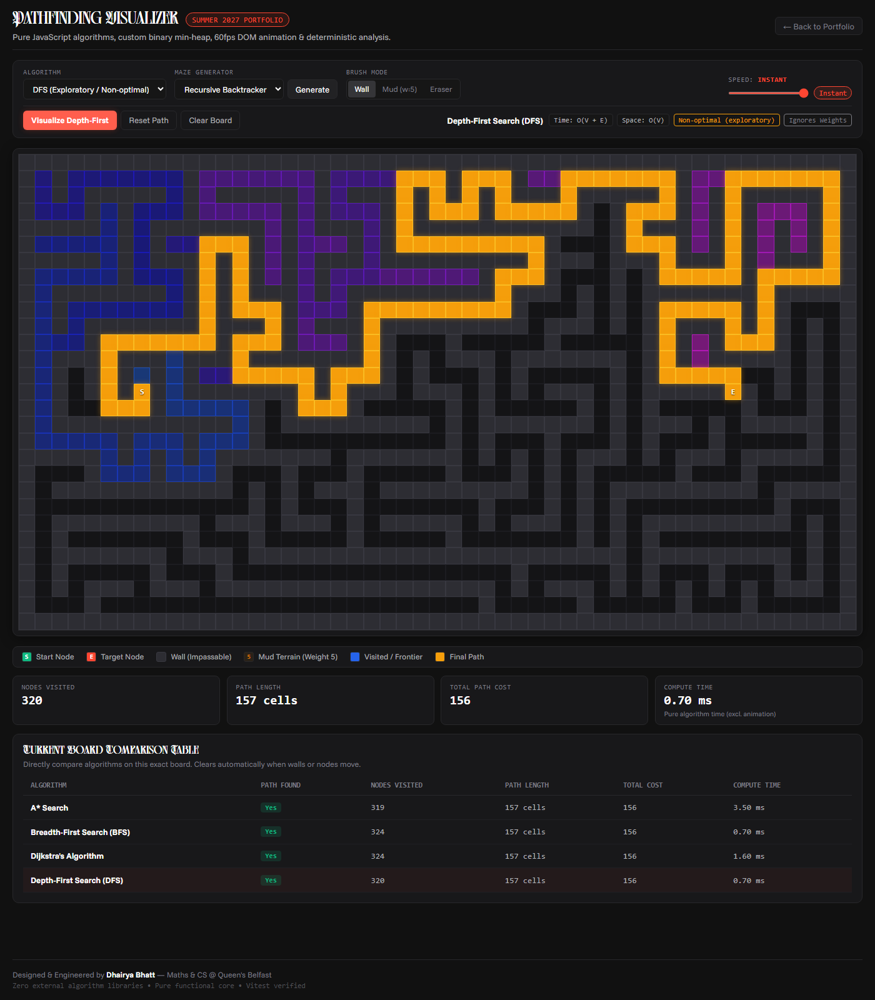

# Pathfinding Visualizer & Algorithmic Analysis Engine

> High-performance graph traversal visualizer, custom binary min-heap, and comparative analysis dashboard built with React 18, Vite, and Vitest.

[](./tests)
[](./dist)
[-FF4632?style=flat-square)](#)

[Live Interactive Demo](https://pathfinding.dhairyabhatt.me) • [Portfolio](https://dhairyabhatt.me)



---

## 1. Overview & Pitch

This project is a deterministic 2D grid pathfinding visualizer built from scratch with zero third-party algorithm or data structure libraries. It includes custom implementations of a binary min-heap, Breadth-First Search (BFS), Depth-First Search (DFS), Dijkstra's Algorithm, A* Search with Manhattan heuristic, and iterative maze generators (Recursive Backtracker & Randomized Prim's). Designed with a strict separation between pure algorithmic graph theory and 60 FPS DOM rendering, it allows direct side-by-side performance benchmarking across identical board topologies.

---

## 2. Core Architecture & Design Decisions

### A. Pure Functions & Step-List Architecture
* **Decision**: All algorithms in `/src/algorithms` are pure functions: `(grid, start, end) -> Result`. They contain zero DOM references, zero React hooks, zero timers, and zero mutations of the input grid.
* **Interview Defense**:
  - **Decoupling**: Decouples algorithmic correctness from UI rendering. The exact same algorithm functions run in headless Node.js unit tests and in the browser.
  - **Deterministic Benchmarking**: Computational runtime is measured with high-resolution `performance.now()` strictly around the algorithm execution, preventing rendering and DOM layout thrashing from polluting benchmark numbers.
  - **Immutability**: The input grid matrix is treated as read-only, preventing unintended side effects and race conditions between concurrent runs.

### B. RAF Animator vs. React State (60 FPS on 1,500 Cells)
* **Decision**: Playback is orchestrated via `requestAnimationFrame` and direct DOM class mutations through a matrix of element references, rather than driving per-step state through React's component tree.
* **Interview Defense**:
  - Re-rendering a 51x29 grid (1,479 cell components) on every animation frame triggers virtual DOM diffing and layout reflows, causing severe dropped frames and CPU bottlenecks.
  - Cell components are memoized (`React.memo`). During animation, `useAnimator` manipulates class lists directly (`cell-visited`, `cell-path`) and computes a dynamic `--visit-ratio` CSS variable for fluid radial gradients.
  - Full React state synchronization only occurs on board clear, wall creation, or upon completion to update statistics cards and history tables.

### C. Dijkstra: Lazy Deletion vs. Decrease-Key
* **Decision**: Lazy deletion over an array-backed binary min-heap rather than decrease-key.
* **Interview Defense**:
  - A traditional decrease-key operation requires maintaining an auxiliary inverted hash map mapping `vertex -> heapIndex` and swapping index entries on every bubble-up and sink-down step, adding substantial memory overhead and CPU cache fragmentation.
  - On a 4-regular planar grid, the maximum degree of any node is 4. Thus $|E| \le 4|V|$, meaning at most 4 entries per vertex can ever be inserted into the heap.
  - The maximum size of the priority queue is bounded by $O(|V|)$, which preserves the optimal $O(|E| \log |V|)$ asymptotic time complexity while running significantly faster in real-world benchmarks due to contiguous memory locality.

### D. A* Optimality Proof & Manhattan Heuristic
* **Decision**: L1 Manhattan distance heuristic $h(n) = |r_1 - r_2| + |c_1 - c_2|$ with tie-breaking on lower $h$.
* **Interview Defense**:
  - **Admissibility**: Movement is restricted to orthogonal cardinal directions (Up, Down, Left, Right) with minimum cell weight $w \ge 1$. The shortest possible path cost between any two cells cannot be strictly less than the Manhattan distance. Therefore, $h(n) \le h^*(n)$ (never overestimates).
  - **Consistency (Monotonicity)**: For any neighbour $n'$ of $n$, $h(n) \le c(n, n') + h(n')$ because Manhattan distance satisfies the triangle inequality and $c(n, n') \ge 1$. A consistent heuristic guarantees that the discovered path to any closed node is already optimal, eliminating the need to re-open closed nodes.
  - **Tie-Breaking**: When two frontier nodes share equal $f = g + h$, selecting the node with the smaller $h$ directs expansion toward the goal along the diagonal, pruning symmetric frontier rings.

### E. Iterative DFS & Iterative Maze Generation
* **Decision**: All DFS and maze carving operations are implemented iteratively with an explicit stack array.
* **Interview Defense**:
  - JavaScript engines enforce a call stack depth limit (typically ~10,000 frames). In large or winding mazes with dead ends, recursive DFS can exceed this limit and crash with `RangeError: Maximum call stack size exceeded`.
  - An explicit heap-allocated stack eliminates recursion depth limits, guarantees predictable memory bounds, and simplifies step recording.

### F. BFS Queue Optimization
* **Decision**: Single array queue with an incrementing `head` integer pointer.
* **Interview Defense**:
  - `Array.prototype.shift()` is $O(N)$ in JavaScript engines because removing the 0th element requires re-indexing all subsequent elements in memory, degenerating BFS queue operations to $O(N^2)$.
  - An integer pointer achieves true $O(1)$ amortized dequeues.

---

## 3. Algorithm Complexity Matrix

| Algorithm | Time Complexity | Space Complexity | Guarantees Shortest Path? | Supports Weights? | Data Structure |
| :--- | :---: | :---: | :---: | :---: | :--- |
| **A* Search** | $O(E \log V)$ | $O(V)$ | **Yes** (Optimal) | **Yes** | Min-Heap + Manhattan Heuristic |
| **Dijkstra** | $O(E \log V)$ | $O(V)$ | **Yes** (Optimal) | **Yes** | Min-Heap (Lazy Deletion) |
| **BFS** | $O(V + E)$ | $O(V)$ | **Yes** (Unweighted only) | No (Uniform 1) | Pointer Queue ($O(1)$ Pop) |
| **DFS** | $O(V + E)$ | $O(V)$ | **No** (Exploratory) | No (Uniform 1) | Explicit Iterative Stack |
| **Recursive Backtracker** | $O(V)$ | $O(V)$ | N/A (Perfect Maze) | N/A | Explicit Stack (2-step jumps) |
| **Randomized Prim's** | $O(E)$ | $O(V)$ | N/A (Spanning Tree) | N/A | Frontier Wall List |

---

## 4. Test Suite Coverage (17 Passing Unit Tests)

All algorithm logic is verified through a rigorous Vitest test suite prior to UI rendering:
1. **Shortest Path Length Invariance**: BFS, Dijkstra, and A* return the exact same path length on grids with known shortest paths.
2. **Weighted Terrain Verification**: Dijkstra and A* return the exact same minimal cost on weighted terrain, while BFS deviates due to ignoring edge weights.
3. **DFS Path Validity**: Verifies continuous 4-way adjacency and wall avoidance without falsely asserting shortest path.
4. **Unreachable Walls**: Verifies all algorithms return `found = false` and `path = []`.
5. **Boundary & Edge Cases**: Verified for `start == end`, adjacent start/end, 1x1 grids, and 1xN corridors.
6. **Heuristic Pruning Property**: Verifies A* visits $\le$ nodes than Dijkstra over multiple pseudo-random seeded grids.
7. **Grid Immutability**: Deep equality assertion before and after algorithm execution.
8. **Heap Invariance**: Verified sorting order and heap property preservation over 500 pseudo-random numbers.
9. **Maze Spanning Tree Reachability**: Verifies 100% reachability across open cells and odd-dimension enforcement.

---

## 5. Getting Started & Development

### Prerequisites
- Node.js >= 18
- npm >= 9

### Install Dependencies
```bash
npm install
```

### Run Unit Tests
```bash
npm run test
```

### Run Local Development Server
```bash
npm run dev
```

### Build for Production
```bash
npm run build
```

---

## 6. What I'd Add Next
- **Bidirectional A* / Dijkstra**: Expanding frontiers simultaneously from both start and end to reduce explored area by up to $50\%$.
- **Hierarchical Pathfinding (HPA\*)**: Pre-computing cluster abstract graphs for ultra-large scale grids (10,000+ nodes) in real-time strategy environments.
- **Dynamic Terrain Topography**: Continuous elevation gradient elevation mapping with diagonal movement and Chebyshev / Octile heuristics.
